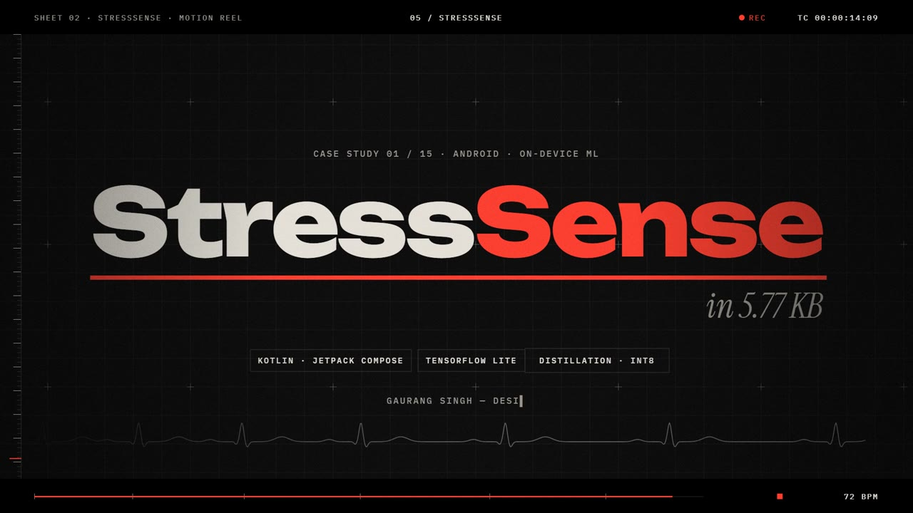
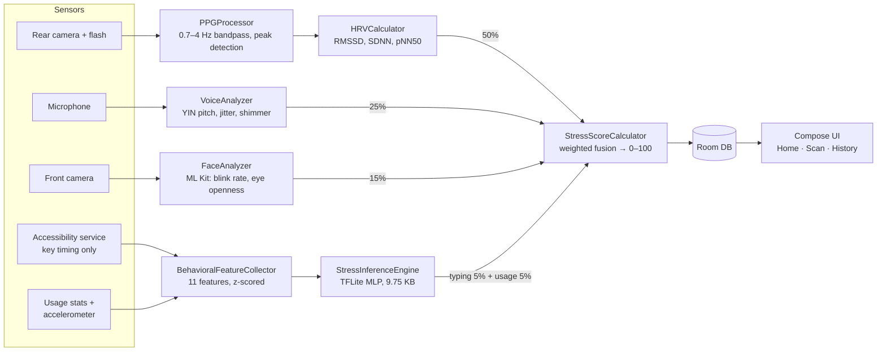

# StressSense — on-device stress estimation from phone sensors

Android app (Kotlin, Jetpack Compose) that estimates a 0–100 stress score using only the phone: camera PPG for heart-rate variability, voice, face, typing rhythm and usage patterns. Everything runs on the device, with no network calls.

## 🎬 Showreel

<p align="center">
  <a href="showreel/stresssense-showreel.mp4"></a>
  <br/><sub><a href="showreel/stresssense-showreel.mp4">▶ Watch the 15s showreel</a> · 1080p60 · built frame by frame in code (<a href="showreel/">source</a>)</sub>
</p>

## Results at a glance

| | Value | How it was measured |
|---|---|---|
| Behavioural model accuracy | **91.1%** (macro F1 0.906) | Shipped `stress_model.tflite` on 450 held-out rows of the **synthetic** dataset, 3 classes (Low / Medium / High) |
| Gradient Boosting teacher | 90.4% test, 91.8% ± 0.9% 5-fold CV | Same synthetic data, same split |
| Model size | **9.75 KB** (9,984 bytes) | `app/src/main/assets/stress_model.tflite`, weights quantised to 8-bit, float32 input and output |
| Inference time | **~1.6 µs** median per sample | Desktop CPU (Intel i5-1135G7) with the LiteRT interpreter. Not yet measured on a phone |
| Fusion weights | HRV 50%, voice 25%, face 15%, typing 5%, usage 5% | `StressScoreCalculator.kt`; weights are re-normalised when a sensor is unavailable |

> **About the data.** No labelled phone-sensor stress dataset was available, so the behavioural model was trained on **synthetic data**. The 11 features were generated from a hidden stress value, with effect directions taken from published research. Because the labels come from the same generator, the 91% shows that the pipeline works end to end (training → distillation → TFLite → Android). It does **not** show how well the model predicts real stress. Validating it on real users (for example with PSS-10 questionnaire scores as labels) is the next step.

## Architecture



The app follows Clean Architecture with MVVM:

| Layer | Contents |
|---|---|
| Presentation | Jetpack Compose screens (Home, Scan, History, Settings, Onboarding, Questionnaire), ViewModels, Navigation |
| Domain | `algorithms/` signal processing, `behavioral/` feature collection and TFLite inference, use cases |
| Data | Room (3 entities), repository, DataStore preferences |
| Services | `PassiveMonitoringService` (foreground), `TypingAccessibilityService`, `DailyAggregationWorker` |

## The behavioural model

[`stree detection/ml_model/`](stree%20detection/ml_model) contains the full pipeline:

1. **`train_model.py`** generates 3,000 synthetic samples with 11 features (typing speed and variance, backspace rate, app switches, unlocks, screen time, social-app share, late-night use, movement variance, steps, call/SMS change). It splits them 70/15/15 and trains a Gradient Boosting classifier (200 trees, depth 5).
2. **`convert_to_tflite.py`** distils the Gradient Boosting model into a small Keras MLP (64 → 32 → 16 → 3) on 8,000 points labelled by the teacher. It then converts the MLP to TFLite with default post-training quantisation, and also writes `feature_stats.txt` (means and standard deviations) for the app.
3. **`evaluate_tflite.py`** re-creates the test split and scores the `.tflite` file that the app actually ships.

Test-set confusion matrix for the shipped model (rows = true, columns = predicted):

| | Low | Medium | High |
|---|---|---|---|
| **Low** | 174 | 11 | 0 |
| **Medium** | 3 | 119 | 13 |
| **High** | 0 | 13 | 117 |

All errors fall in a neighbouring class. Low and High are never confused with each other.

Reproduce:

```bash
pip install scikit-learn pandas numpy joblib ai-edge-litert
python "stree detection/ml_model/train_model.py"
python "stree detection/ml_model/evaluate_tflite.py" app/src/main/assets/stress_model.tflite app/src/main/assets/feature_stats.txt
```

Re-running `convert_to_tflite.py` also needs `tensorflow`.

## Privacy

- No network permission is used, and nothing leaves the device.
- Camera frames and audio buffers are processed in memory and then discarded.
- The typing service records only the time between keys and the number of corrections, **never which keys were pressed**.
- History is stored locally in Room.

## Build and run

Requirements: Android Studio (Hedgehog or newer), JDK 17, Android SDK 34. Minimum device: Android 8.0 (API 26).

- **Android Studio:** open the repo folder, let Gradle sync, then press Run.
- **Command line:**

```bash
./gradlew assembleDebug        # Windows: gradlew.bat assembleDebug
adb install -r app/build/outputs/apk/debug/app-debug.apk
```

## Limitations and next steps

- The behavioural model has only been validated on synthetic data (see above).
- The fusion weights and the HRV-to-score mapping are hand-set from the literature, not learned.
- Camera PPG is sensitive to finger pressure and movement. Signal-quality checks exist, but they have not been benchmarked against a chest strap.
- Next: collect a small labelled dataset (PSS-10 score plus a week of passive data), measure latency on real phones, and learn the fusion weights.

## Tech

Kotlin · Jetpack Compose · Material 3 · Hilt · Room · CameraX · ML Kit · TensorFlow Lite · WorkManager · Python · scikit-learn · Keras
